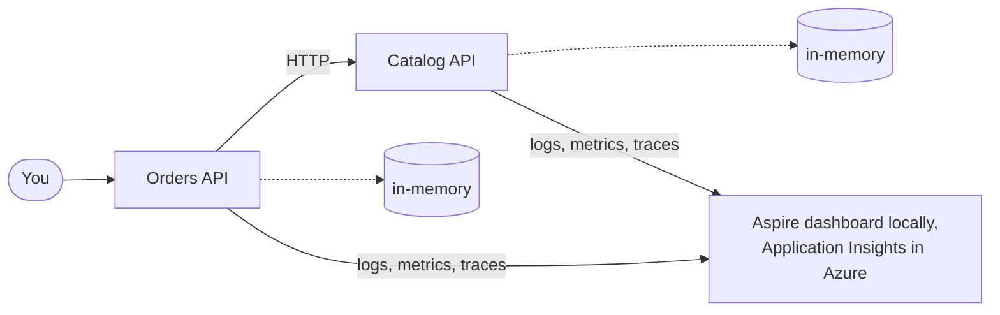

# MicroShop

A small .NET 10 microservice system for learning **CI/CD**, **observability** and **logging** end to end.



Placing an order checks the product in Catalog, reserves stock, then saves the order.

## Run it

You need the .NET 10 SDK.

```powershell
dotnet run --project src/MicroShop.AppHost
```

Open the dashboard link it prints.

| What | Where |
|---|---|
| Orders API (Scalar) | http://localhost:5102/scalar |
| Catalog API (Scalar) | http://localhost:5101/scalar |

Try these orders in Scalar, then find each one under **Traces** in the dashboard:

| Product | What happens |
|---|---|
| 1, 2, 3 | Works |
| 4 | Works once, then is out of stock |
| 98 | Works, but takes 3 seconds |
| 99 | Catalog fails; Orders retries 3 times, then returns 503 |
| Any other | Product not found |

## Test it

```powershell
dotnet test MicroShop.slnx
```

Don't start the app while the integration tests are running. Aspire allows one running copy of an AppHost, so it stops the one the tests are using and they fail with `TaskCanceledException`. Starting the app first is fine.

## Learn from it

Read in this order:

1. [Architecture](docs/1-architecture.md): what each part does and why
2. [CI/CD](docs/2-ci-cd.md): how code reaches production
3. [Observability](docs/3-observability.md): logs, metrics, traces, and practice exercises
4. [Deploy to Azure](docs/4-deploy-to-azure.md): step-by-step, from GitHub to production and teardown
5. [Interview notes](docs/5-interview-notes.md): likely questions, short answers, and the code behind them
