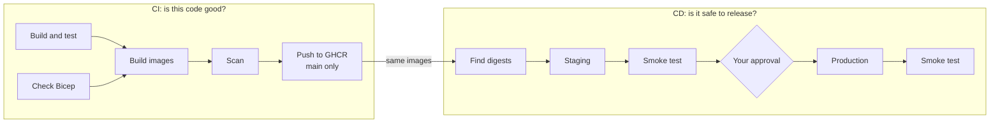

# 2. CI/CD

| File | Purpose |
|---|---|
| [`ci.yml`](../.github/workflows/ci.yml) | Tests every pull request; publishes images from main |
| [`cd.yml`](../.github/workflows/cd.yml) | Promotes one version through the environments; rollback |
| [`deploy.yml`](../.github/workflows/deploy.yml) | Reusable: deploys to one environment |
| [`dependabot.yml`](../.github/dependabot.yml) | Opens pull requests for dependency updates |

## Why CI and CD are separate

- **Different triggers.** CI runs on every pull request. CD runs only for tested code on main.
- **Different permissions.** CI has no Azure access, so a malicious pull request can't reach production.
- **Rollback without rebuilding.** CD can redeploy an old version on its own.

## The terms

- **Continuous integration:** merge small changes often, and test each one automatically.
- **Continuous delivery:** every good build *could* be released; a person decides when. **This project does this.**
- **Continuous deployment:** every good build *is* released automatically. Remove the approval and you have it.

## Principles to find in the files

| Principle | Where |
|---|---|
| **Build once, promote the same image** | CD never builds. Both environments receive the same digest. |
| **Digests, not tags** | `cd.yml` resolves the tag to `@sha256:...`, which can't be changed. |
| **Fail fast** | `ci.yml` runs formatting before building, and unit tests before integration tests. |
| **Shift left on security** | NuGet audit, image scan before push, Dependabot. |
| **Least privilege** | `permissions:` on each job; one Azure identity per environment. |
| **No stored passwords** | OIDC sign-in to Azure. |
| **Pinned actions** | Full commit SHAs, because tags can be moved. |
| **Infrastructure as code** | Bicep, deployed with the app from the same commit. |
| **Verify the deployment** | The smoke test checks the exact version and the call to Catalog. |
| **Traceability** | The git commit is the image tag, the `/version` response and `service.version` in telemetry. |

## How OIDC sign-in works

1. The workflow asks GitHub for a short-lived token that says "I am this repository, deploying to `staging`".
2. Azure checks that against the trust created by `setup-azure.ps1`.
3. Azure returns a short-lived access token that works only for the staging resource group.

There is no secret to leak. The environment only accepts the `main` branch, so a workflow on another branch can't use it.

## Rolling back

**Actions > CD > Run workflow**, then enter the full SHA of the last good commit. Staging runs first, then production after your approval.

With a real database, rollback is harder. Migrations must be backward compatible, so the old code still works with the new schema. The usual approach is **expand and contract**: add the new column, move the code over, and remove the old column in a later release.

## Deployment strategies

| Strategy | How it works |
|---|---|
| **Rolling** | Replace instances gradually |
| **Blue-green** | Run both versions, then switch all traffic at once |
| **Canary** | Send a small share of traffic to the new version and watch it |
| **Feature flags** | Deploy the code switched off, and turn it on later |

Here, Container Apps uses **single revision mode**: the new version gets traffic once it is ready, and the old one serves until then. Canary is available by switching to multiple revisions with traffic weights.

## Limitations

- If a run on main fails and you re-run it, the image is rebuilt and the tag can point to a new digest.
- Production waits for approval. If a newer version reaches that point, approve the newest and cancel the older one.
- A failed smoke test stops the release, but doesn't roll back automatically.
