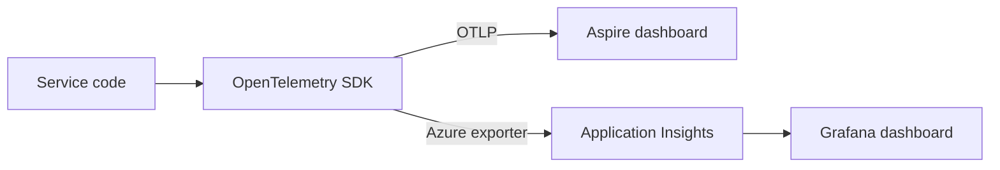

# 3. Observability

**Monitoring** tells you *that* something is wrong. **Observability** lets you find out *why*, including for problems you didn't predict.

## The three pillars

| | Question | Cost | In this project |
|---|---|---|---|
| **Metrics** | Is something wrong? | Low | [`OrderMetrics.cs`](../src/Orders.Api/Telemetry/OrderMetrics.cs), [`CatalogMetrics.cs`](../src/Catalog.Api/Telemetry/CatalogMetrics.cs) |
| **Traces** | Where is it wrong? | Medium | [`OrderTracing.cs`](../src/Orders.Api/Telemetry/OrderTracing.cs), plus automatic spans |
| **Logs** | Why is it wrong? | High | `logger.Log...` calls |

A typical investigation goes **metric → trace → log**. The trace id links them.

## How telemetry flows



The services use only standard OpenTelemetry APIs. [`TelemetryExtensions.cs`](../src/MicroShop.ServiceDefaults/TelemetryExtensions.cs) chooses the destination from environment variables. To use Grafana Cloud or another OTLP backend, change settings rather than application code.

### How one trace spans two services

When Orders calls Catalog, a `traceparent` header is added automatically. Catalog reads it and joins the same trace. This is the **W3C Trace Context** standard.

## Structured logging

```csharp
// Good: ProductId becomes a searchable field.
logger.LogWarning("Not enough stock for product {ProductId}", productId);

// Bad: just text. You can't search by product reliably.
logger.LogWarning($"Not enough stock for product {productId}");
```

| Level | Use for |
|---|---|
| Debug | Detail while developing |
| Information | Normal business events |
| Warning | Unexpected, but handled |
| Error | An operation failed |
| Critical | The service can't continue |

Never log passwords, tokens or personal data.

## Custom metrics

| Metric | Type | Note |
|---|---|---|
| `orders.created` | Counter | Only goes up; graph the rate |
| `orders.failed` | Counter | Tagged with `reason` |
| `orders.value` | Histogram | Spread of values |
| `orders.in_progress` | UpDownCounter | Goes up and down |
| `catalog.stock.level` | Observable gauge | Read on a schedule; tagged with `category` |

**Cardinality** is the number of distinct tag values. Each one creates a new time series, which costs money. `reason` has three values, so it's safe. `order_id` would have millions, so it belongs in logs and traces.

**Azure limitation:** Application Insights stores a histogram's sum, count, min and max, but not its buckets. You get an average order value there, but not percentiles. The Aspire dashboard and Prometheus-style backends do show percentiles. Request duration percentiles still work in Azure, because each request is stored.

## What to put on a dashboard

- **RED**, for services: **R**ate, **E**rrors, **D**uration
- **USE**, for resources: **U**tilisation, **S**aturation, **E**rrors
- **Four golden signals** (Google): latency, traffic, errors, saturation

Use **percentiles**, not averages. An average of 100 ms can hide 1% of users waiting 10 seconds.

## SLI, SLO, SLA and error budget

- **SLI** (indicator): what you measure. *Share of orders that don't fail with a 5xx.*
- **SLO** (objective): your target. *99.9% over 30 days.*
- **SLA** (agreement): a promise to customers, with consequences.
- **Error budget**: what the SLO allows to fail. 99.9% allows about 43 minutes of downtime in 30 days. When it's used up, pause features and work on reliability.

**Alert on symptoms** that users feel, such as errors and slowness. Every alert should need action, or people start ignoring them.

## Exercises

Start the app, place the order in Scalar, and investigate before reading the answer.

**1. Order product 98. Why is it slow?**

<details><summary>Answer</summary>

Open the trace. Nearly all of the time is inside the call to Catalog's `GET /products/98`, so the problem is in Catalog.
</details>

**2. Order product 99. How many times was Catalog called, and why did it take several seconds?**

<details><summary>Answer</summary>

Four times: one attempt and three retries. The time is mostly the growing delay between retries. Catalog's log shows the exception, with the same trace id.
</details>

**3. Order product 4 twice. Is the second result an error?**

<details><summary>Answer</summary>

It's a 409, and `orders.failed` goes up with `reason = out_of_stock`. The system did its job, so it's a warning rather than an error. The dashboard may still mark the trace red, because HTTP client spans treat any 4xx response as an error.
</details>

**4. Stop Catalog in the Aspire dashboard, then place an order. Does Orders stay healthy?**

<details><summary>Answer</summary>

Yes. `/health` still passes and the order returns 503 with `catalog_unavailable`. That is isolation working.
</details>

## Queries for Azure (KQL)

Run these in **Log Analytics workspace > Logs**.

Slowest requests:

```kusto
AppRequests
| where TimeGenerated > ago(1h)
| top 10 by DurationMs
| project TimeGenerated, AppRoleName, Name, DurationMs, ResultCode, OperationId
```

Everything in one trace (paste an `OperationId`):

```kusto
union AppRequests, AppDependencies, AppTraces, AppExceptions
| where OperationId == "PASTE-HERE"
| project TimeGenerated, Type, AppRoleName, Name, Message, DurationMs
| order by TimeGenerated asc
```

Failed orders by reason:

```kusto
AppMetrics
| where Name == "orders.failed"
| summarize Failed = sum(Sum) by Reason = tostring(Properties.reason), bin(TimeGenerated, 15m)
```

Data collected per table, to control cost:

```kusto
Usage
| where TimeGenerated > ago(7d)
| summarize MB = round(sum(Quantity), 2) by DataType
| order by MB desc
```
